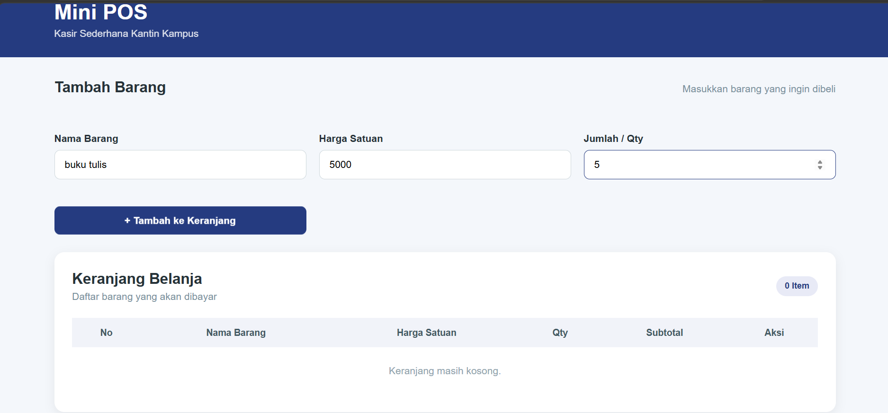
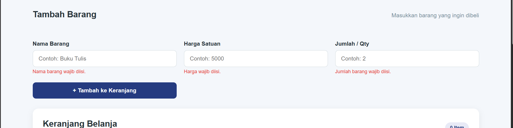
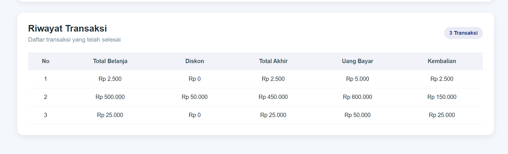

# Mini POS - Kasir Sederhana Kantin Kampus

## 1. Identitas

- **Nama Lengkap:** Regina Cahyani Puteri
- **NIM:** 124140063
- **Kelas Praktikum:** RB

## 2. Deskripsi Aplikasi

### Gambaran Umum
Mini POS merupakan aplikasi web sederhana yang digunakan untuk membantu proses transaksi kasir pada kantin atau toko kampus. Aplikasi ini memungkinkan pengguna untuk memasukkan barang, menghitung total belanja, mendapatkan diskon, melakukan pembayaran, menghitung kembalian, dan melihat riwayat transaksi.

### Tujuan Pembuatan
Aplikasi ini dibuat untuk menerapkan konsep dasar pemrograman web menggunakan HTML, CSS, dan JavaScript. Aplikasi juga menerapkan validasi input, perhitungan otomatis, manipulasi DOM, serta penyimpanan data menggunakan `localStorage`.

### Studi Kasus
Studi kasus yang digunakan adalah sistem kasir sederhana pada kantin kampus. Pengguna dapat memasukkan nama barang, harga, dan jumlah barang. Sistem kemudian menghitung subtotal, total belanja, diskon, total akhir, pembayaran, dan kembalian.

## 3. Panduan Menjalankan

Langkah-langkah untuk menjalankan aplikasi secara lokal:
1. Buka **Visual Studio Code**.
2. Buka folder project **Mini-POS**.
3. Pastikan file `index.html`, `style.css`, dan `script.js` berada dalam folder project yang sama.
4. Buka file `index.html`.
5. Klik kanan pada file `index.html`.
6. Pilih **Open with Live Server**.
7. Browser akan terbuka dan menampilkan aplikasi Mini POS.
8. Aplikasi sudah dapat digunakan.

## 4. Daftar Fitur

### Validasi Form
- [x] Validasi nama barang wajib diisi.
- [x] Validasi nama barang minimal 3 karakter.
- [x] Validasi harga wajib diisi.
- [x] Validasi harga minimal Rp500.
- [x] Validasi jumlah barang wajib diisi.
- [x] Validasi jumlah barang harus berupa angka bulat minimal 1.
- [x] Menampilkan pesan error jika input tidak sesuai.

### Kalkulator Keuangan

- [x] Menghitung subtotal setiap barang.
- [x] Menghitung total belanja.
- [x] Menghitung diskon 10% jika total belanja minimal Rp50.000.
- [x] Menghitung total akhir setelah diskon.
- [x] Menginput nominal pembayaran.
- [x] Menghitung kembalian secara otomatis.
- [x] Menampilkan status pembayaran jika uang kurang atau mencukupi.

### Keranjang dan Transaksi

- [x] Menambahkan barang ke keranjang.
- [x] Menampilkan daftar barang dalam keranjang.
- [x] Menghapus barang dari keranjang.
- [x] Menyelesaikan transaksi.
- [x] Membuat transaksi baru.
- [x] Menampilkan riwayat transaksi.

### LocalStorage

- [x] Menyimpan data keranjang ke `localStorage`.
- [x] Mengambil data keranjang dari `localStorage`.
- [x] Menyimpan riwayat transaksi ke `localStorage`.
- [x] Mengambil riwayat transaksi dari `localStorage`.

---

## 5. Tangkapan Layar (Screenshot)

### Form Input Utama

Tampilan utama aplikasi yang digunakan untuk memasukkan nama barang, harga, dan jumlah barang.

### Validasi Error

Tampilan ketika pengguna memasukkan data yang tidak sesuai dengan aturan validasi.

### Hasil Perhitungan dan Riwayat

Tampilan setelah barang dimasukkan ke keranjang, pembayaran dilakukan, dan riwayat transaksi ditampilkan.

## 6. Penjelasan Teknis Singkat

### A. Penanganan Validasi Input
Validasi input dilakukan menggunakan fungsi `validasiForm()` pada JavaScript. Sistem mengambil nilai dari input nama barang, harga, dan jumlah barang, kemudian memeriksa apakah data sudah sesuai dengan ketentuan.

Jika terdapat input yang kosong atau tidak sesuai, sistem akan menampilkan pesan error dan data tidak akan dimasukkan ke dalam keranjang.
